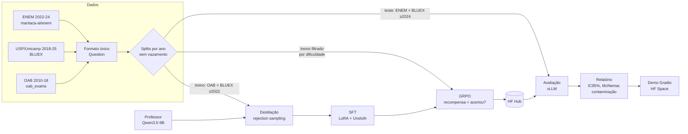

# 🎓 Vestibular-BR

**Um modelo de 2B parâmetros consegue aprender a raciocinar em provas brasileiras com aprendizado por reforço?**

Vestibular-BR é um projeto de pesquisa e engenharia que treina e avalia LLMs em **ENEM, vestibulares da USP/Unicamp e Exame da OAB**, com foco em três perguntas:

1. **RL vs. imitação:** para um modelo pequeno, o que rende mais — imitar raciocínios de um modelo grande (**SFT por rejection sampling**) ou aprender por tentativa e erro com recompensa verificável (**GRPO**)? E combinar os dois?
2. **Imagem vs. descrição:** em questões com figuras, modelos multimodais de 2026 se saem melhor vendo a **imagem real** ou lendo uma **descrição textual** dela? ([um estudo de 2023 com GPT-4V](https://arxiv.org/abs/2311.14169) achou que a descrição vencia.)
3. **Contaminação:** os modelos *entendem* as questões ou *decoraram* provas que estavam na internet? Medimos isso **embaralhando as alternativas** e comparando provas antigas vs. recentes.

---

## Resultados

Tabela completa: [`results/LEADERBOARD.md`](results/LEADERBOARD.md).

| Modelo | ENEM 2022–24 | USP/Unicamp 24–25 | Observação |
|---|---|---|---|
| Chute aleatório | 19.7% | 20.1% | linha de base |
| Qwen3.5-2B (base) | – | – | |
| Qwen3.5-2B + SFT | – | – | |
| Qwen3.5-2B + GRPO | – | – | |
| Qwen3.5-2B + SFT + GRPO | – | – | |
| Qwen3.5-9B (base) | – | – | professor |

Todas as acurácias vêm com **intervalo de confiança de 95% (bootstrap)**, e comparações entre modelos usam **teste de McNemar pareado**. Em provas de ~180 questões, diferenças de 2–3 pontos costumam ser ruído.

---

## Como funciona



### Dados e divisão (sem vazamento)

| Split | Conteúdo | Questões | Uso |
|---|---|---|---|
| `train` | OAB (todas) + USP/Unicamp 2018–2022 | 3.141 | SFT e GRPO |
| `dev` | USP/Unicamp 2023 | 162 | escolher checkpoints |
| `test` | ENEM 2022–2024 + USP/Unicamp 2024–2025 | 860 | número final |

**O modelo nunca vê ENEM no treino.** Além disso, treino e teste são separados por *ano*, o que mede generalização e não memorização. Há uma checagem automática de enunciados duplicados entre os splits.

### Técnicas

- **Rejection sampling (destilação):** o Qwen3.5-9B (mesma família, 4,5x maior) resolve cada questão de treino 4 vezes. Ficam só os raciocínios que **chegaram na resposta certa** (verificado pelo gabarito), e entre eles o mais curto.
- **GRPO** ([DeepSeekMath](https://arxiv.org/abs/2402.03300)) com recompensa verificável: `+1` se acertou, `+0.1` pelo formato e uma penalidade leve para respostas longas demais. Usa `loss_type="dr_grpo"` (sem viés de tamanho) e `beta=0` (sem modelo de referência, economiza memória).
- **Filtro de dificuldade:** o GRPO só aprende com questões em que o modelo às vezes acerta e às vezes erra. Questões 100% certas ou 100% erradas dão vantagem zero, então medimos pass@4 do modelo base e treinamos só nas do meio.
- **LoRA em 4 bits (Unsloth)** para caber numa GPU T4 gratuita do Kaggle.
- **Avaliação com vLLM**, com LoRA carregada sem merge e *self-consistency* opcional (`-n 5`).

---

## Rodando

```bash
pip install -e ".[dev]"
vbr data                                              # baixa e prepara os 3 datasets
vbr eval -b test -m mock:random                       # baseline aleatório
vbr distill -m vllm:Qwen/Qwen3.5-9B --k 4             # dataset de SFT (GPU)
vbr eval -b enem -m vllm:Qwen/Qwen3.5-2B --mode image # imagem real (GPU)
vbr contamination -b bluex -m vllm:Qwen/Qwen3.5-9B    # alternativas embaralhadas (GPU)
vbr report                                            # leaderboard + gráficos
python app/app.py                                     # demo local
```

Tudo que usa GPU roda no Kaggle (T4 x2, gratuita):
- [`notebooks/01_destilacao_kaggle.ipynb`](notebooks/01_destilacao_kaggle.ipynb)
- [`notebooks/02_avaliacao_vllm_kaggle.ipynb`](notebooks/02_avaliacao_vllm_kaggle.ipynb)
- [`notebooks/03_treino_sft_grpo_kaggle.ipynb`](notebooks/03_treino_sft_grpo_kaggle.ipynb)

Também dá para avaliar modelos via API (qualquer endpoint compatível com OpenAI; use `--rpm` para respeitar limites): `gemini`, `openai`, `anthropic`, `hf` (Inference Providers), `maritaca`, `openrouter`, `local` (vLLM server), `vllm` (offline na GPU), `mock`.

## Estrutura

```
src/vestibular/
  data/loaders.py      # ENEM, BLUEX, OAB → formato único
  data/splits.py       # divisão por ano + checagem de vazamento
  prompts.py           # modos caption/image/blind + permutação de alternativas
  parsing.py           # extração robusta da letra
  backends/            # OpenAI-compatível (async + retry), vLLM, mock
  eval/runner.py       # avaliação retomável (sobrevive a quedas)
  eval/metrics.py      # bootstrap IC95%, McNemar, consistência sob permutação
  train/distill.py     # rejection sampling
  train/sft.py         # SFT com LoRA
  train/grpo.py        # GRPO + filtro de dificuldade
  train/rewards.py     # funções de recompensa
  report.py            # leaderboard, contaminação, gráficos
app/app.py             # demo Gradio (leaderboard, explorador de erros, modo ao vivo)
tests/                 # testes unitários (rodam no CI sem GPU/API)
```

## Limitações

- As descrições de imagem do ENEM vêm do dataset (feitas por humanos para o caderno do ledor). Em uma prova real o modelo não teria isso, por isso o modo `image` existe.
- O teste de permutação detecta memorização da *posição* da resposta, não do conteúdo. É um sinal, não uma prova de contaminação.
- 2B parâmetros em GPU gratuita limitam o número de passos de GRPO; os resultados são de um orçamento pequeno de computação.

## Créditos dos dados

[ENEM — Maritaca AI](https://huggingface.co/datasets/maritaca-ai/enem) (Apache-2.0) · [BLUEX](https://huggingface.co/datasets/portuguese-benchmark-datasets/BLUEX) (Almeida et al., 2023) · [OAB Exams](https://huggingface.co/datasets/eduagarcia/oab_exams) (Delfino et al., 2017)
